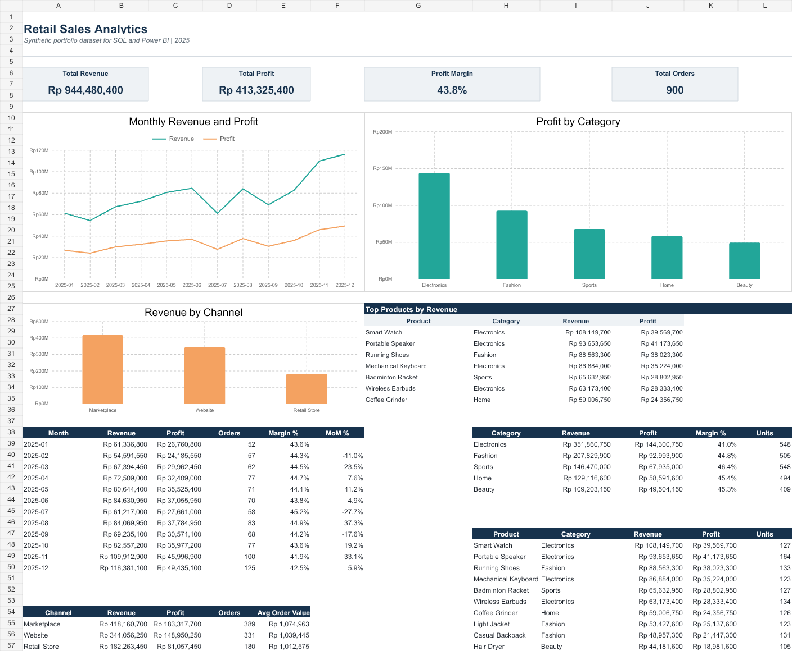
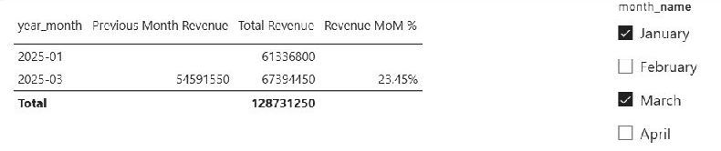
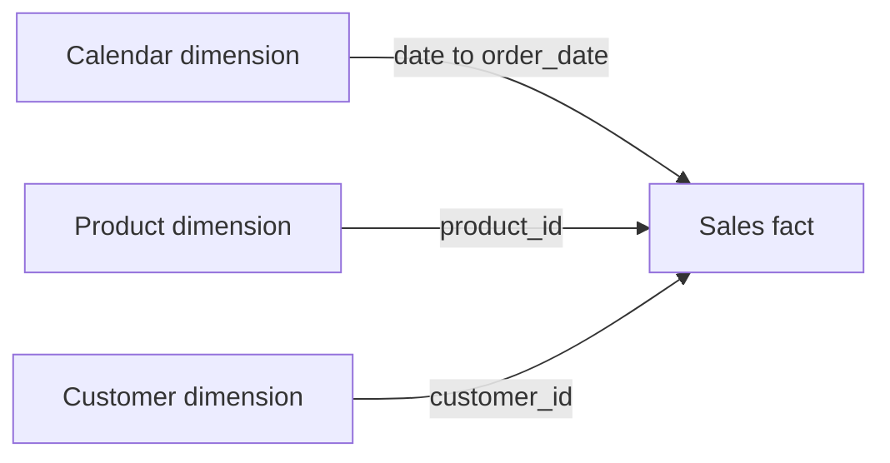

# Retail Sales Analytics - SQL and Power BI

A beginner-friendly portfolio project that analyzes synthetic retail transactions
with SQLite and prepares a star schema for an interactive Power BI dashboard.
The data is fictional and reproducible. It does not represent a real company.

## Dashboard preview



### Monthly Revenue with January and March selected



March revenue grew **23.45%** compared with February, which remains the
comparison month even though it is outside the slicer selection. January has
no prior month in the dataset, and the total spans two months, so both MoM
values are blank.

Download and open the interactive dashboard in Power BI Desktop:
[Retail_Sales_Performance_Dashboard.pbix](Retail_Sales_Performance_Dashboard.pbix).

## Key results

| KPI | Result |
|---|---:|
| Revenue | Rp944,480,400 |
| Profit | Rp413,325,400 |
| Profit margin | 43.76% |
| Orders | 900 |
| Transaction rows | 1,513 |

The analysis covers monthly trends, category and product performance, sales
channels, customer segments, and city-level contribution.

### Business insights from the synthetic data

- **Electronics leads in revenue, with a lower margin.** It generated
  Rp351.9 million, or 37.3% of total revenue. Its 41.01% margin was 2.75
  percentage points below the overall margin, making it a starting point for
  examining product costs and discounts.
- **Marketplace leads on both revenue and average order value.** It generated
  Rp418.2 million across 389 orders. At Rp1.075 million per order, its average
  order value was higher than Website (Rp1.039 million) and Retail Store
  (Rp1.013 million).
- **December had the highest revenue, with a margin below the annual figure.**
  Revenue reached Rp116.4 million, up 5.88% from November. December margin was
  42.48% versus 43.76% for the year. The generator gives November and December
  more orders on average and allows deeper discounts, so the pattern reflects
  a simulated seasonal scenario.

## Business questions

- How do revenue and profit change month by month?
- Which categories and products perform best?
- Which channels have the highest revenue and average order value?
- Which customer segments and cities contribute the most revenue?
- Does revenue growth maintain a healthy profit margin?

## Project structure

```text
Retail_Sales_Analytics_Source.xlsx   Power BI-ready workbook and dashboard reference
Retail_Sales_Performance_Dashboard.pbix  Interactive Power BI dashboard
retail_sales.db                      SQLite database
data/                                CSV fact and dimension tables
sql/01_schema.sql                    Star-schema tables and indexes
sql/02_analysis_queries.sql          KPI, trend, ranking, and segmentation queries
query_outputs/                       Verified SQL results
powerbi/DAX_Measures.txt             Measures to copy into Power BI
powerbi/Dashboard_Build_Guide.md     Step-by-step dashboard instructions
scripts/generate_data.py             Reproducible synthetic data generator
PORTFOLIO_DESCRIPTION.md             CV, portfolio, and interview wording
```

## Data model



## Run the SQL project in PowerShell

Python 3.11 or newer is enough; no packages are required.

```powershell
python .\scripts\generate_data.py
python -m sqlite3 .\retail_sales.db
```

Inside SQLite, try:

```sql
.headers on
.mode column
SELECT COUNT(*) AS sales_rows FROM fact_sales;
SELECT ROUND(SUM(revenue), 0) AS total_revenue FROM fact_sales;
.read sql/02_analysis_queries.sql
.quit
```

If `python -m sqlite3` is unavailable in your Python version, use a SQLite GUI or
open `retail_sales.db` from a database extension in VS Code. The generator itself
always validates the database using Python's built-in SQLite library.

## Open or rebuild the Power BI dashboard

Open `Retail_Sales_Performance_Dashboard.pbix` with the free Power BI Desktop
application to explore the interactive report. The included dashboard contains
revenue, profit, and units-sold KPI cards, a revenue trend, and revenue by sales
channel. Open **Monthly Revenue** to filter the monthly table and compare revenue
with the previous calendar month.

To rebuild it from scratch, follow `powerbi/Dashboard_Build_Guide.md`. Import the `Sales`, `Products`,
`Customers`, and `Calendar` sheets from `Retail_Sales_Analytics_Source.xlsx`,
create the relationships, and paste the measures from `DAX_Measures.txt`.

The workbook's `Dashboard` sheet is a visual reference. The Power BI dashboard
should use slicers and DAX so every chart responds interactively.

The generator uses the SQL in `sql/02_analysis_queries.sql` to export the KPI,
monthly, category, channel, and top-product CSV files in `query_outputs/`.

## Data quality checks

- The generator checks the SQLite sales row count and total revenue against the
  generated source rows before replacing the database. A mismatch stops the run.
- All foreign keys match their date, product, and customer dimensions.
- No negative-profit transaction rows are present.
- The included SQL analysis script runs successfully against SQLite.

## SQL concepts demonstrated

- Relational star schema with primary and foreign keys
- Joins between fact and dimension tables
- Aggregation, grouping, and conditional calculations
- Common table expressions (CTEs)
- `LAG` for month-over-month analysis
- `DENSE_RANK` for product ranking
- Null-safe division with `NULLIF`
- Indexes and validation checks

## Suggested next improvement

Add a tooltip page and a drill-through page for product details, then publish a
browser-viewable version through Power BI Service when an appropriate account is
available.

## Author

Muh Agung Gustiansyah  
[LinkedIn](https://www.linkedin.com/in/muh-agung-gustiansyah-ba879b297/) ·
[GitHub](https://github.com/agunggust)

